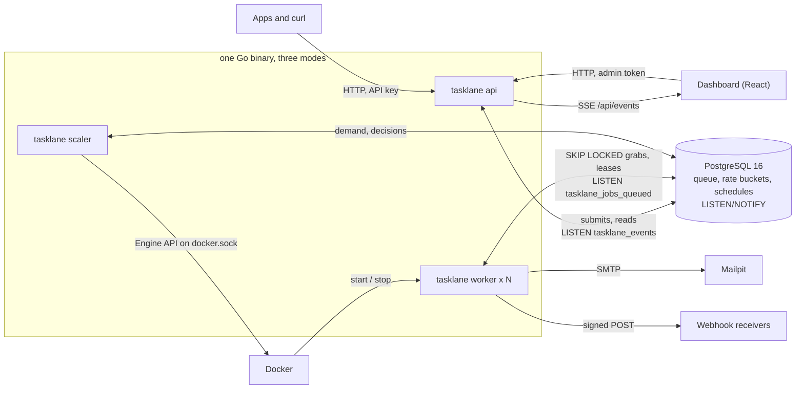

# Tasklane

Tasklane is a background job engine written in Go, with PostgreSQL as its only piece of
infrastructure. Apps submit jobs over HTTP with an API key, workers grab them with
`SELECT ... FOR UPDATE SKIP LOCKED` under a lease, and a scaler process watches the queue and
starts or stops worker containers through the Docker Engine API. Teams share the workers in
proportion to their plan, each plan has rate limits and a cap on running jobs, and a React
dashboard shows all of it live over Server-Sent Events fed by Postgres `LISTEN/NOTIFY`. It runs
on a laptop with one command, and the numbers below were measured that way.

<!-- Demo GIF to come: docs/demo.gif -->

## Features

**Reliability**
- Jobs are claimed under a lease that the worker renews while it runs. If a worker dies, a
  reaper puts its jobs back in the queue when the lease runs out, so no job is lost.
- Retries with exponential backoff and jitter, up to `max_attempts`, then `dead`. A handler can
  mark an error permanent (a bad payload, a 4xx) and skip the retries.
- A time limit per job type, and a clean shutdown: on SIGTERM a worker stops taking jobs and
  finishes the ones it has within a grace period.
- `Idempotency-Key` on submit, backed by a unique index, so a repeated request returns the
  original job.
- Dead jobs grouped by type and the shape of their error (ids, numbers and quoted values
  normalised away), and a whole group can be retried in one statement.

**Scheduling**
- Priorities 0 to 9 with aging, so a low priority job still runs under a steady stream of
  urgent ones.
- Delayed jobs with `run_at` or `delay` (`90s`, `2h30m`), up to a year out.
- Cron schedules with an IANA time zone, at most once a minute, fired by a single leader and
  exactly once per tick.

**Fairness and plans**

| Plan       | Share weight | Running jobs cap | Jobs per minute | Burst  |
|------------|-------------:|-----------------:|----------------:|-------:|
| Free       | 1            | 2                | 100             | 200    |
| Pro        | 3            | 6                | 1,000           | 2,000  |
| Enterprise | 10           | 10               | 10,000          | 20,000 |

- When every team is busy, workers serve them in the ratio of their share weights. A team at
  its cap is skipped and its spare slots go to the others.
- A plan switch is an admin call and applies on the next grab.

**Rate limits**
- Incoming: a token bucket per team. Over the limit is `429` with `Retry-After`, and every
  submit reports `X-RateLimit-Limit` and `X-RateLimit-Remaining`.
- Outgoing: a bucket per job type shared by every worker (`email.send=10/s,webhook=200/s` by
  default), so a flood can't hammer an SMTP server or a webhook receiver.
- Overload: past `QUEUE_CEILING` (100,000) runnable jobs, submits get `503`.

**Autoscaling**
- The scaler sizes the worker pool from the backlog and the plans' caps, scales up at once
  and down one worker at a time after a cool-down, and logs every decision with its reason.
- Workers are Docker containers started and stopped through the Engine API on the socket,
  with `net/http` rather than the Docker SDK. A `noop` driver runs everything in memory.

**Live dashboard**
- Overview with queue depth against worker count, throughput, and a "Flood 10k jobs" button.
- Jobs with live progress and bulk retry or cancel, a job page with payload, result and
  timeline, workers with the scaler's decision log, teams with plans, usage and API keys,
  schedules, and dead job groups.
- A mock mode (MSW) that runs every page in the browser with no backend.

**Real job types**
- `webhook`: a JSON POST signed like Stripe's, `Tasklane-Signature: t=<time>,v1=<HMAC-SHA256>`.
- `image.resize`: fetches an image (or draws a built-in sample) and scales it to up to eight
  widths in pure Go, writing each file atomically.
- `email.send`: plain text over SMTP from the payload or a template, delivered to Mailpit
  locally.
- `sleep` and `flaky` for demos and tests.

## Architecture



`api`, `worker` and `scaler` are the same binary run in three modes, as separate containers so
the workers scale on their own. Postgres is the queue, the rate limiter, the scheduler's lock
and the event bus. A trigger on `jobs` sends a `NOTIFY` on every status or progress change;
every api `LISTEN`s and relays to the browsers connected to it, so it doesn't matter which api
a browser reaches. Each event has an id, and a browser that reconnects with `Last-Event-ID`
gets what it missed.

## How it works

### Grabbing a job: SKIP LOCKED, leases and the reaper

A worker wakes on `NOTIFY` when jobs are queued (with a slow poll as a fallback), picks whose
turn it is, and claims the oldest job at that team and priority level with
`FOR UPDATE SKIP LOCKED`, setting `status = running`, `locked_by` and
`lease_until = now() + 30s`. `SKIP LOCKED` means two workers never claim the same job and
never wait on each other's job rows. While the job runs, the worker renews the lease every
third of its length. If the worker crashes, the reaper (every 10s, under an advisory lock so
one worker reaps at a time) finds the expired lease and puts the job back to `queued`. An
attempt is counted at the grab, so a job that keeps crashing its worker still ends up `dead`.

### Fair share by plan weight, with aging

A grab is two queries with a decision in Go between them. The first reads the backlog without
locks: for each team under its cap, its weight, a decaying count of jobs it has started, and
the oldest runnable job at each priority level (one index probe per level, so it stays cheap
however long the queue is). Teams are tried in order of `served / weight`, lowest first. Inside
a team, the level with the highest aged priority wins, where aged priority is
`priority + waited / 30s`: a priority 0 job that has waited 4.5 minutes ties a fresh 9.

The grab itself locks the team's `team_usage` row, then in a second statement (with a fresh
snapshot in read committed) counts the team's running jobs and takes a job only under the cap.
The served count decays by a factor of e each minute, so it roughly counts the last minute and
old work stops counting against a team quickly.

### Token buckets in Postgres

A bucket is one row in `rate_buckets`. Refilling it from `updated_at` and spending from it is
a single statement, `INSERT ... ON CONFLICT DO UPDATE ... WHERE` there are enough tokens,
`RETURNING` what is left, so any number of api processes can share a bucket without
overspending. A request is fully validated before it is charged, so a bad batch costs nothing.
When a job of a rate limited type is grabbed without a token, it goes straight back to
`queued` with its attempt and its team's turn given back, and that worker leaves the type
alone until the next token is due.

### The autoscaler's rules

One scaler leads, through an advisory lock on its own connection. Every second it:

1. Lists its containers and their heartbeats, and removes any that died.
2. Measures demand in one query: runnable jobs, and slots, the sum over teams of
   `min(waiting + running, plan cap)`. Types held back by a rate limit in the last 10s are left
   out, since more workers wouldn't run them any sooner.
3. Sets the target to `ceil(runnable / 500)`, at most `ceil(slots / WORKER_CONCURRENCY)`,
   clamped to 2..10. Above the current count, it starts the difference at once. Below it, it
   waits out a 20s cool-down, then stops one worker every 3s, choosing the one running the
   fewest jobs. A stopped worker gets SIGTERM and drains.
4. Records `up`, `down` or `hold` with its reason, which the dashboard shows live.

The cap bound matters: one Enterprise team can run 10 jobs at once however many workers exist,
so the backlog says how many workers are wanted and the caps say how many are useful.

### Exactly-once schedule ticks

Every api runs a scheduler, and each second each one tries `pg_try_advisory_lock`; the holder
fires schedules through that same connection, so a process that lost its session can't fire.
Firing is one transaction: lock the due schedules with `FOR UPDATE SKIP LOCKED`, insert each
one's job with the idempotency key `schedule:<id>:<tick>` and `ON CONFLICT DO NOTHING`, and
move `next_run_at` on. The unique index on `(team_id, idempotency_key)` means even two
processes that both believe they lead can't fire the same tick twice. The next run counts from
now, so after an outage a schedule runs one catch-up rather than one per missed tick.

## Numbers

Measured on an Apple M4 (4 performance and 6 efficiency cores) with Docker Desktop given 10
CPUs and 8 GB, Postgres 16 on its defaults, workers running one job each. These are single
runs, and repeats of the same run varied by up to about 10%, so treat small differences as
noise. [docs/benchmarks.md](docs/benchmarks.md) has the setup, the raw output and the caveats.

**The autoscaler under a flood.** 10,000 `image.resize` jobs from one Enterprise team:

| What                                   | When  |
|----------------------------------------|-------|
| 20 batches of 500 submitted            | 0.5s  |
| scaler starts eight workers (2 to 10)  | 1s    |
| 10 workers running                     | 2.1s  |
| queue empty                            | ~26s  |
| cool-down over, first step down        | 33.8s |
| back to 2 workers, one step every 3s   | ~56s  |

Every job succeeded. The same flood on two fixed workers took 45s.

**Throughput and the bottleneck.** Five times the workers finished only 1.8x sooner, so I
profiled the database with `pg_stat_activity` sampling and `pg_stat_statements`. Two things
were serialising the work:

- Every grab and every finish of a team took that team's `team_usage` row: the grab to bump
  its counts, the finish (through a trigger) to decrement `running`. A finish spent 2.97ms of
  its 3.3ms waiting for that row.
- Postgres commits transactions that `NOTIFY` one at a time, each holding a cluster-wide lock
  until its WAL is flushed, and every job made three such commits.

Two changes came out of it. Short jobs no longer write a progress update before they finish
(WAL flushes per job went from 2.9 to 1.9). And running jobs are now counted through a
partial index instead of kept in the team row, so finishes never touch it (a finish went from
3.3ms to 0.25ms).

| Run (10,000 jobs, one team)              | Before    | After     |
|------------------------------------------|----------:|----------:|
| `image.resize`, autoscaled 2 to 10       | 337-357/s | 426/s     |
| empty jobs, autoscaled 2 to 10           | 1,279/s   | 1,939/s   |
| `image.resize`, two fixed workers        | 208/s     | not rerun |

The best paired comparison (same session) is 357 to 426 jobs/s, +19%; other runs were inside
the noise. Most of the remaining gap is not the database at all: an image job takes about 9ms
on two workers and about 22ms on ten, on the same code, because ten busy containers spill onto
the M4's efficiency cores and share ten CPUs with Postgres and the api. The benchmark matrix
was cut short when the disk filled, and a clean repeated comparison is still owed.

## Quick start

You need Docker, Go 1.25 and Node 24.

```sh
make up            # Postgres, the api on :8080, the scaler (which starts 2 workers), Mailpit, httpbin
make web-install   # npm ci in web/
make web-dev       # the dashboard on http://localhost:5173, proxying /api to :8080
```

- API key for the `default` team: `tk_live_localdev`
- Admin token for the dashboard and admin routes: `dev-admin-token`
- Mailpit, where `email.send` delivers: http://localhost:8025
- `make down` stops the scaler, removes its workers, and takes the stack down.

`default` starts on Pro, whose burst of 2,000 is too small for the 10k flood button. Switch it
to Enterprise on the Teams page first. `make web-dev-mock` runs the dashboard on mock data with
no backend at all.

To run the processes outside Docker, `make db` starts only Postgres, then `make run-api`,
`make run-worker` and `make run-scaler` (which logs what it would do instead of starting
containers). Configuration is all environment variables with defaults in
[config/config.go](config/config.go).

Submit a job:

```sh
curl -i http://localhost:8080/api/jobs \
  -H 'Authorization: Bearer tk_live_localdev' \
  -H 'Content-Type: application/json' \
  -H 'Idempotency-Key: welcome-ada-1' \
  -d '{"type": "email.send", "priority": 7,
       "payload": {"to": "ada@example.com", "template": "welcome", "data": {"name": "Ada"}}}'
```

The first call answers `201 Created` with the job; the same call again answers `200 OK` with
the same job instead of queueing a second email. Add `"delay": "90s"` or `"run_at"` to run it
later, then watch it in the dashboard and in Mailpit.

## API

Job and schedule routes take a team's key as `Authorization: Bearer tk_live_...` and only see
that team's data. Admin routes take the admin token the same way.

| Method | Path | What |
|--------|------|------|
| POST   | `/api/jobs` | Submit a job (`Idempotency-Key`, `run_at` or `delay`) |
| POST   | `/api/jobs/batch` | Submit up to 500 jobs |
| GET    | `/api/jobs` | List, newest first, with `status`, `type`, `cursor`, `limit` |
| GET    | `/api/jobs/{id}` | A job with its timeline |
| POST   | `/api/jobs/{id}/cancel` | Cancel a queued or retrying job |
| POST   | `/api/jobs/{id}/retry` | Requeue a failed, dead or cancelled job |
| GET    | `/api/schedules` | The team's schedules |
| POST   | `/api/schedules` | Create one: cron, time zone, job type, payload |
| GET    | `/api/schedules/{id}` | One schedule |
| PUT    | `/api/schedules/{id}` | Replace it; `enabled: false` pauses it |
| DELETE | `/api/schedules/{id}` | Delete it |
| GET    | `/api/plans` | Admin: the plans |
| GET    | `/api/teams` | Admin: teams with plan and usage |
| POST   | `/api/teams` | Admin: create a team |
| PUT    | `/api/teams/{id}/plan` | Admin: switch plan |
| GET    | `/api/teams/{id}/keys` | Admin: a team's keys |
| POST   | `/api/teams/{id}/keys` | Admin: create a key, shown in full once |
| POST   | `/api/teams/{id}/keys/{key}/revoke` | Admin: revoke a key |
| GET    | `/api/admin/jobs/{id}` | Admin: any team's job with its timeline |
| POST   | `/api/admin/jobs/{id}/cancel` | Admin: cancel any team's job |
| POST   | `/api/admin/jobs/{id}/retry` | Admin: retry any team's job |
| GET    | `/api/stats` | Admin: counts, rates and the last 150 samples |
| GET    | `/api/workers` | Admin: live workers, their jobs, scaler decisions |
| GET    | `/api/dead-groups` | Admin: dead jobs grouped by type and error |
| GET    | `/api/dead-groups/{id}/jobs` | Admin: a group's latest jobs |
| POST   | `/api/dead-groups/{id}/retry` | Admin: requeue the whole group |
| GET    | `/api/events` | Admin: the SSE stream, also takes `?token=` |
| GET    | `/healthz` | Health check |

## Project layout

```
main.go          picks the mode (api, worker, scaler) and wires everything
config/          environment variables and their defaults
routes/          URL to controller wiring, and the HTTP tests
controllers/     HTTP handlers, request and response shapes
middleware/      API key and admin token auth, request logging
services/        the logic: queue, fair share, worker, scheduler, scaler, rate limits, events
repositories/    hand-written SQL with pgx, one file per table group
drivers/         how the scaler starts and stops workers: docker, noop
jobs/            the job handlers: webhook, image.resize, email.send, sleep, flaky
models/          plain data types, importing nothing from the project
migrations/      SQL migrations, embedded and run on startup
web/             the React dashboard
deploy/          Dockerfile and docker-compose.yml
scripts/bench/   the flood benchmark
docs/            design notes and benchmarks
```

Imports go one way: `routes -> controllers, middleware -> services -> repositories, drivers,
jobs -> models`, with `config` below everything. There is no `utils` package; a helper lives
next to the code that uses it. [docs/design.md](docs/design.md) covers the data model, the lock
order and the reasoning behind each part in more depth.

## Testing

```sh
go test -short ./...   # unit tests only, no Docker needed
make test              # everything, integration tests included; needs Docker running
```

Unit tests cover backoff, fair share picking, the scaler's arithmetic, rate limit maths, the
progress throttle, cron parsing, and event encoding and replay. Integration tests start a real
Postgres 16 (and Mailpit for email) with testcontainers and cover double grabs, lease expiry,
idempotency, starvation, plan weights and caps, auth and key revocation, rate limits and
overload, scheduler leader failover, events crossing api processes, replay after a reconnect,
dead job groups, and the scaler's loop and leadership. The Docker driver is tested against a
fake daemon on a unix socket.

The dashboard checks with `npm run lint` and `npm run build` in `web/`. CI runs `go vet`,
`go test -race ./...` with the integration tests, and the dashboard's lint and build on pushes
to `main` and on pull requests.

## Design notes and trade-offs

- **Postgres only, no Redis.** One stateful dependency to run, back up and reason about. The
  queue, rate limits, leader election and the event bus all live in the same transactions as
  the data they describe, so a job's state change and its event can't disagree, and a write
  that rolls back announces nothing. Redis could take over rate limits or events behind the
  same services if load ever showed Postgres to be the limit.
- **A `NOTIFY` per job change, cost accepted.** Notifying commits are serialised, which caps
  empty jobs at about 1,900 a second on this laptop. That is far above what the real job types
  need here, and it buys a live dashboard with no polling and no second system. Finishing a job
  and grabbing the next in one transaction is the next step if the ceiling ever matters.
- **Laptop scope.** The scaler drives Docker, not Kubernetes, though the driver interface is
  three methods and a pod driver would fit behind it. Plans are switched by an admin call, not
  billing, and the dashboard uses one shared admin token instead of users and logins.

## License

MIT, see [LICENSE](LICENSE).
